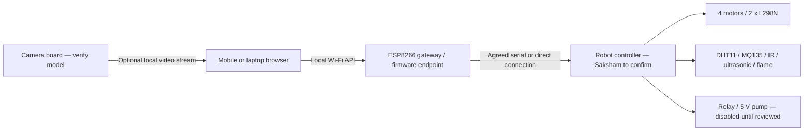

# VANARAKSHAK 2.0 — Autonomous Forest Fire Fighter Rover

> **Educational school-science model**, not a certified firefighting or fire-alarm system. Demonstrate without flames, smoke, or heat. This rover must not be used at a real fire.

**Slogan:** *Detect Early. Respond Smart. Protect Forests.*

## The robot
A 4-wheel mobile forest-protection demonstration rover using:
- Four DC drive motors; two L298N dual-channel motor-driver modules.
- Flame sensor(s), infrared obstacle sensors, ultrasonic ranging sensor(s).
- DHT11 temperature / relative-humidity sensor.
- MQ135 gas/air-quality sensor (raw or calibrated *relative* reading; not reliable smoke ppm).
- ESP8266 Wi-Fi module and a camera module currently described as "ESP8266 Cam"; **verify exact camera PCB and chipset before implementing a stream** (often this means a separate ESP32-CAM board).
- Relay module, **5 V DC pump**, and tubing for a supervised optional water demonstration.
- Lithium-ion power **only via a protected, commercially assembled solution approved by an adult/teacher**; no DIY cell packs or charging instructions.
- Switches, wiring, recycled-material forest scenery, and a chassis.
- **Controller architecture TBD with Saksham**: an Arduino Uno was mentioned earlier but is not confirmed in the latest component list. The ESP8266 alone may not expose enough suitable pins for every motor channel and sensor. Final electrical pin map must wait for an exact board inventory.

## Two operating modes
**MANUAL** — A connected browser displays directional driving controls, speed setting, telemetry, and an immediately accessible STOP. Motion commands are momentary (press-and-hold); releasing the control or losing communication causes the *robot firmware* to stop the motors.

**AUTONOMOUS** — A deliberately enabled indoor demonstration where firmware uses ranging/IR sensors to avoid tabletop obstacles at low speed. The robot must stop for sensor failures, stale commands, faults, a lost connection where relevant, or a STOP request. Real forest navigation is out of scope.

## Team split
| Owner | Deliverable |
|---|---|
| **You — web/UI** | Mobile-first dashboard, connection state, demo mode, manual controls, mode switching UI, live DHT11/MQ135 cards, obstacle and flame status, camera panel (when board verified), robust emergency STOP and tests |
| **Saksham — robot/firmware** | Controller and board inventory, sensor acquisition, motor drivers, autonomous behavior, relay and pump safety, Wi-Fi protocol, watchdogs, telemetry, on-robot stopping, hardware testing |
| **Both** | API agreement, safe integration, environmental model, five-minute science-fair presentation |

## System architecture (logical only; not a wiring plan)

The browser communicates with a **mock** transport initially. A live adapter will be connected only after Saksham confirms board model, endpoint behavior, network protection and stop watchdog. Do not embed credentials or expose device endpoints to the public internet.

## Web interface — your project
A lightweight, dependency-free, responsive starter dashboard lives in **[web/index.html](web/index.html)**. It runs without a server-side account and uses clearly labeled **SIMULATED** data until an actual robot API is independently tested.

- [Web interface requirements](docs/13_WEB_DASHBOARD.md)
- [Shared API contract](docs/14_API_CONTRACT.md)
- [Team responsibilities and integration](docs/15_TEAM_WORKFLOW.md)
- [Power and integration decisions](docs/16_POWER_AND_HARDWARE_DECISIONS.md)
- [Web UX and integration acceptance tests](docs/17_WEB_TEST_PLAN.md)

Open `web/index.html` locally for a **simulated preview**. Live motor or pump commands are not wired to a real robot by this starter. Treat any mock readings as generated demonstration values, not measurements.

## Read the full documentation
1. [Scope and judging goals](docs/01_PROJECT_BRIEF.md)
2. [Actual part inventory](docs/02_PARTS_AND_MATERIALS.md)
3. [Architecture and wiring ownership](docs/03_WIRING_AND_POWER.md)
4. [Firmware state machines](docs/04_FIRMWARE_AND_STATES.md)
5. [Eco-friendly rover diorama](docs/05_3D_BUILD_PLAN.md)
6. [Safety-first testing](docs/06_SAFE_TEST_PLAN.md)
7. [Five-minute team script](docs/07_PRESENTATION_SCRIPT.md)
8. [Safety and limitations](docs/08_SAFETY_AND_LIMITATIONS.md)
9. [Development milestones](docs/09_ROADMAP.md)
10. [Judging checklist](docs/10_JUDGING_CHECKLIST.md)
11. [Troubleshooting](docs/11_TROUBLESHOOTING.md)
12. [Provisional pin-map requirements](docs/12_PIN_MAP.md)
13. [Web dashboard design](docs/13_WEB_DASHBOARD.md)
14. [API and sample JSON](docs/14_API_CONTRACT.md)
15. [Team and branch strategy](docs/15_TEAM_WORKFLOW.md)
16. [Power/hardware decisions](docs/16_POWER_AND_HARDWARE_DECISIONS.md)
17. [UI and integration test plan](docs/17_WEB_TEST_PLAN.md)

## Repository status and legacy files
`src/main.cpp`, `src/fire_logic.h`, `include/config.h`, `platformio.ini`, and `test/fire_logic_test.cpp` are **LEGACY Arduino Uno stationary-demo code** from VANARAKSHAK 1.0. They do **not** control this 4WD rover. They are retained to preserve earlier work and must not be uploaded to the newly described vehicle as if complete. Saksham can implement a separate verified firmware target under `firmware/` once the controller configuration is confirmed.

[Web-team Codex prompt](CODEX_STARTER_PROMPT.md) | [Contributor / agent rules](AGENTS.md)

## Required outstanding confirmations
1. Exact boards: ESP8266 variant, camera board marking, and whether Arduino Uno remains part of the robot.
2. Motor-driver, sensor and power-rail specifications reviewed by Saksham and a teacher.
3. Camera capabilities and stream URL.
4. Network transport and full API behavior, including heartbeat/timeout and emergency stop.
5. Safely protected assembled battery supply and physical OFF switch.

**No physical hardware tests or live network integration have been claimed.**
