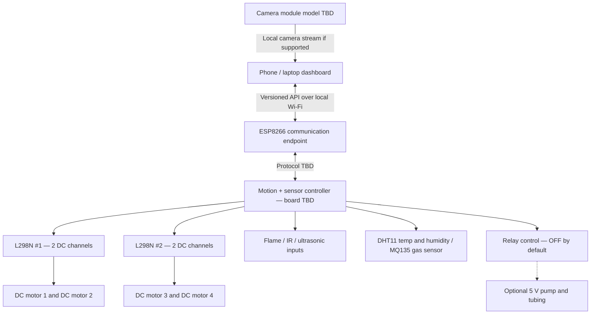

# 03 — Architecture and wiring ownership (NOT a final physical schematic)

**Do not follow old Uno stationary prototype pin map to build this new 4WD rover.** Exact model markings, controller/level-shifting, grounding, protected power and motor-drive current limits are not yet confirmed. **Saksham and a teacher/adult** must review the complete physical schematic before power is applied.

## Functional architecture

**This is a data-flow drawing, not an electrical diagram.** Avoid deciding GPIO pins before the exact controller board and number of sensors are confirmed.

## Hardware design decisions to resolve
1. Is an Arduino Uno still used for many sensor/motor pins? The component list names ESP8266, but its GPIO/ADC capacity may be insufficient alone.
2. How are 4 DC motor channels grouped across the two L298N modules? Does the driver match each motor's *measured and specified* current at expected load?
3. What voltage and current do motors and each sensor module require? A 5 V device and 3.3 V ESP8266 logic are not interchangeable.
4. Which exact module was called "ESP8266 Cam"? Standard ESP32-CAM camera code cannot be assumed compatible.
5. What verified power architecture provides suitable protected supplies for controller(s), motors, sensors and 5 V pump?
6. Which module performs emergency motor stop if browser/network link is lost?
7. Is the pump/relay electrically isolated and physically distant from the sensor/logic area?

## Safe deployment principles
- Power remains OFF while wiring is changed.
- Commercial preassembled and protected lithium-ion supply only, adult-approved; no DIY pack/charging design.
- Real motors and pump need correctly rated independent power switching, not GPIO supply.
- Pump OFF at startup and until the wet stage is explicitly approved; keep water/other liquids away from exposed electronics.
- Physical master OFF switch and accessible emergency stop are required.
- A web STOP button complements, **not replaces**, an on-device command watchdog.
- Limit rover to supervised indoor demos on a clear floor or contained arena, away from people, animals, fire or water.

## After board inventory
Saksham creates a schematic in `firmware/docs/`, documenting each confirmed physical pin, logic level, driver current rating, connector and protection. The front-end **must not depend on specific pins**; it depends on the documented JSON API instead.
