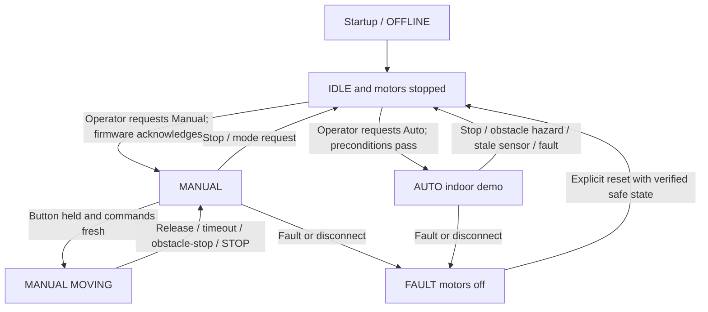

# 04 — Shared behavioral states and firmware handoff

Saksham owns the rover firmware and autonomy. You own browser rendering and command requests. Both agree on observable states in `docs/14_API_CONTRACT.md`.

## State diagram

## Motion safety requirements (firmware, not only frontend)
- Boot into IDLE, drivers inactive.
- Require successful mode transition acknowledgment.
- Manual motion needs frequent command/heartbeat refresh with a **bounded watchdog**, e.g., 500 ms target configurable by measured link behavior; expiry stops all four motors.
- Browser sends STOP immediately on pointer release/cancel, window blur, page visibility loss, lost connection or emergency STOP.
- Firmware prioritizes STOP above drive commands, handles command sequence ordering and refuses stale/replayed commands.
- AUTO mode is supervised indoor obstacle avoidance only. On invalid/stale obstacle sensor, unsafe distance, communications/safety fault, or physical switch OFF, motion must stop.
- No transition from reconnect directly into movement. Re-arm manually.
- Safe speed cap defined in firmware; a UI slider cannot override it.
- Pump/relay OFF by default; pump activation capability disabled until supervised safety review.

## Sensor reporting
| Source | Field(s) | UI handling |
|---|---|---|
| DHT11 | temperatureC, humidityPct, valid, sampledAt | Show °C / %RH, not faster than source refresh |
| MQ135 | mq135Raw, mq135RelativeIndex, calibrated, sampledAt | Label relative / uncalibrated; no invented smoke ppm |
| Flame module(s) | detected, valid | Warning indicator only, not a certified fire alarm |
| IR module(s) | blocked, valid | Obstacle direction if provided |
| Ultrasonic | distanceCm, valid | Numeric distance or unavailable |
| Power | batteryPct? optional, valid | Never fabricate percentage if battery monitor absent |
| Camera | supported + safe local URL | May be on separate module |
| Controls | mode, motion, pumpEnabled, fault | Reflect **acknowledged robot state**, not button intention |

## Integration sequence
Start mocked UI -> Saksham publishes fixture JSON -> both sign off contract -> connect telemetry on local network -> verify STOP and timeouts with drive motors **physically disengaged** -> carefully test indoor motion under teacher supervision -> enable autonomous only after obstacle-stop tests. No fire/smoke demos.
