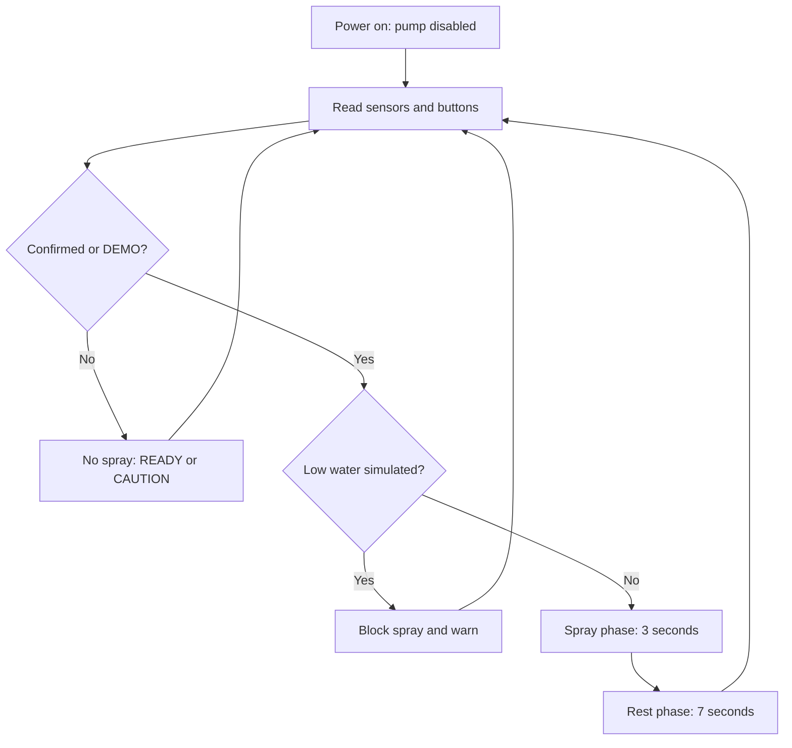

# 04 — Firmware architecture and states

The firmware uses Arduino `millis()` non-blocking timing: no `delay()` in the main loop. Its exact real-hardware behavior needs calibration, especially the flame sensor active level and LM35 analog reference.

## Input semantics
- `flame`: D2 = LOW by default, typical flame module detection behavior.
- `tempC`: `analogRead(A0) * ADC_REFERENCE_VOLTS / 1023 * 100` for an LM35. Verify calibration.
- `DEMO`: D3 button to GND toggles an internal latched demo alert; 40 ms debounce.
- `LOW_WATER`: D4 button to GND means tank-empty *simulation*, not a measured water sensor.

## Alert severity
| Inputs | Alert | Green LED | Red LED / piezo | Blue spray LED |
|---|---|---|---|---|
| No fire signs, no demo, normal water | READY | On | Off | Off |
| Exactly one warning input | CAUTION | Off | Flash/beep | Off |
| Flame AND temp >= 42 C consistently for 2 s | CONFIRMED | Off | Flash/beep | 3 s on / 7 s off |
| Demo latched on, no low-water | CONFIRMED | Off | Flash/beep | 3 s on / 7 s off |
| Confirmed + low-water button held | CONFIRMED + LOW WATER | Off | Flash/beep | Off |
| Ready + low-water button held | LOW WATER warning | Off | Flash/beep | Off |

## Internal spray state machine

Servo moves only during the spray phase. The **blue LED shows intended spray phase** even while actual pump output remains switched off in code. Any newly claimed measurements must be validated with hardware.

## Tuning
- In `include/config.h`, adjust `CONFIRM_TEMP_C` after real sensor calibration, not to force an unsafe demonstration.
- `SPRAY_ON_MS = 3000`, `SPRAY_OFF_MS = 7000`.
- `ENABLE_PUMP_OUTPUT = false` for all first-build demos.
- Use the Serial Monitor at **115200 baud** to inspect temperature, flame, demo, water, alert, spray.

## Known constraints
- A typical inexpensive IR flame sensor can produce false positives under bright light and misses some conditions; using flame + heat is still not a validated wildfire detector.
- Heat changes at a remote LM35 may be slow. The demo button intentionally does not require sensor triggering.
- Blue-LED activity describes software request, not measured delivered water. No flow meter or actual water-level sensor is present.
- After power interruption, the pump gate defaults LOW; software cannot guarantee safety if wiring is incorrect.
